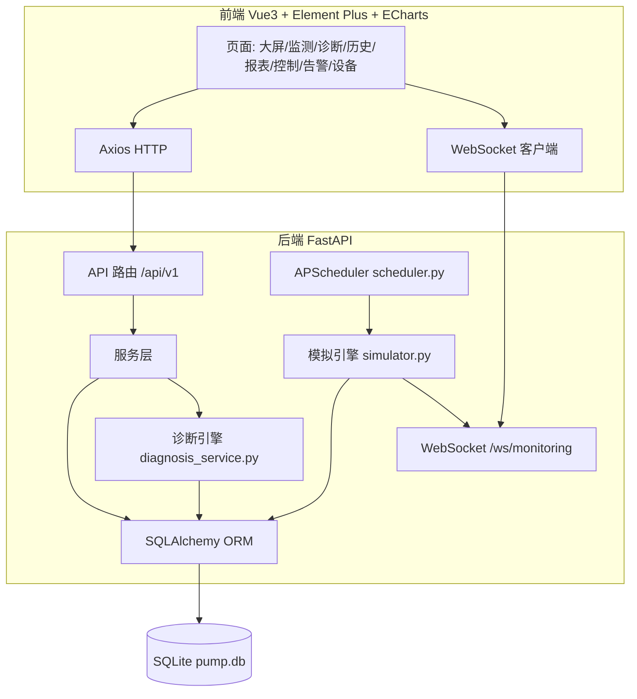

# 01 技术栈与架构

## 1. 技术选型

### 后端
- **Python 3.11 + FastAPI**：自带 Swagger/ReDoc 接口文档，答辩时可直接演示；Pydantic 参数校验；原生 async 支持 WebSocket。
- **SQLAlchemy 2.0**：ORM 屏蔽数据库差异，未来从 SQLite 切换 PostgreSQL 只需改连接串。
- **NumPy + SciPy**：示功图生成、Savitzky-Golay 平滑、鞋带公式面积计算。
- **scikit-learn**：KNN 分类器作为诊断的机器学习方法。
- **APScheduler**：周期驱动数据模拟、诊断与告警判定。
- **WebSocket（FastAPI 原生）**：实时推送数据到前端大屏。

### 前端
- **Vue 3（组合式 API）+ TypeScript + Vite**：组件化、类型安全、热更新快。
- **Element Plus**：表格、表单、卡片、仪表盘等 UI 组件。
- **ECharts（vue-echarts 直接用 echarts）**：示功图闭合曲线、趋势曲线、仪表盘、饼图。
- **Pinia**：设备选中态、实时数据缓存、用户登录态。
- **Axios**：统一封装请求/响应拦截。

### 数据库
- **SQLite**：零配置、单文件 `backend/data/pump.db`，随项目拷贝即可演示。架构上预留时序库切换能力。

## 2. 系统架构

**数据主线**：APScheduler 每隔 N 秒（默认 3 秒）为每台运行设备生成一条实时监测数据 + 每隔 2 个周期生成一张示功图，经规则诊断后写入数据库，并通过 WebSocket 推送到前端，实现大屏实时刷新。

## 3. 可扩展点

`backend/app/services/datasource.py` 定义了 `DataSource` 抽象接口，当前实现为 `SimulatedDataSource`（模拟数据）。若接入真实设备，只需实现 `MqttDataSource` 等并替换全局 `data_source` 实例，其余代码无需改动。
